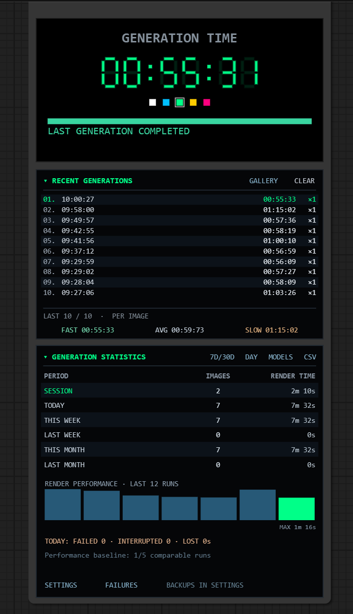

<div align="center">

# ⏱️ ComfyUI Batch Image Timer Extended

### Generation Monitor · History · Analytics · GPU & VRAM · Storage


**A customizable, on-canvas generation timer and long-term monitoring dashboard for ComfyUI.**

**Extended edition by Piotr Karwowski** · MIT License

[Features](#-features) · [Installation](#-installation) · [How to use](#-how-to-use) · [Data & privacy](#-data--privacy) · [Troubleshooting](docs/TROUBLESHOOTING.md) · [Changelog](CHANGELOG.md)

</div>

---

> **Extended edition by Piotr Karwowski.** This project is based on [hermankwan/ComfyUI-Batch-Image-Timer](https://github.com/hermankwan/ComfyUI-Batch-Image-Timer), originally developed by **Herman Kwan** and distributed under the **MIT License**. This extended edition adds generation history, persistent analytics, optional GPU monitoring, workflow previews and more. It is not presented as an official upstream release. The original copyright and MIT license are retained in [LICENSE](LICENSE). See [NOTICE.md](NOTICE.md) for the separate attribution of the original and extended editions.

## 📷 Preview



*Screenshot of an earlier working extended build. The v1.9.2 interface additionally includes a separate GPU & VRAM panel, the TOOLS & PANELS module and expanded settings. Replace this image with a current v1.9.2 screenshot before wider promotion.*

## ✨ Features

| Area | What's included |
| --- | --- |
| ⏱️ **GENERATION TIME** | Live seven-segment timer in `MM:SS:CC` (minutes, seconds, hundredths), five selectable LED colors, sampler progress and stage status. |
| 🖼️ **RECENT GENERATIONS** | Recent render times, FAST / AVG / SLOW in one row, image and prompt hover preview, gallery, image opening, workflow recall where the workflow is available. |
| 📊 **GENERATION STATISTICS** | Server-side SQLite totals for session, today, calendar weeks/months and rolling periods, performance chart, model comparisons and CSV export. |
| 🎮 **GPU & VRAM MONITOR** | Separate collapsible on-node GPU load / VRAM / temperature view, optional sampling, card selection, detailed MONITOR popup. NVIDIA data when supported. |
| 💾 **OUTPUT STORAGE** | Saved-image file sizes and optional on-demand scan of the server's ComfyUI output folder. |
| 🧰 **TOOLS & PANELS** | Clickable SETTINGS, FAILURES, ANALYTICS and MONITOR popups, separate from statistics. |
| 🔔 **Notifications** | Optional browser sound with volume and TEST SOUND, plus optional desktop notifications. |
| 🛡️ **Data tools** | SQLite backups and restore, export/import of settings and statistics, database status and system checks. |

### A timer that does not change batch size

The node **does not have a `total_images` setting** and does **not** create images itself. Configure the number of images in your generation workflow (for example, `Empty Latent Image → batch_size`). The main stopwatch measures **one complete workflow execution**. It is not a separate GPU-inference measurement for each image.

If a batch generates multiple files, the statistics try to count verified output images from ComfyUI history. If a custom save node does not report output files in standard metadata, a batch-size estimate may be displayed with `~`. See [Known limitations](#-known-limitations).

## 📦 Installation

**Manual installation is currently the reliable method.** This independently named edition is **not automatically listed in ComfyUI Manager** until it is separately published/registered.

### ComfyUI Portable (Windows)

1. Stop the **ComfyUI Python server** completely, not just its browser tab.
2. Download this repository using **Code → Download ZIP**.
3. Extract the repository directory into `ComfyUI_windows_portable/ComfyUI/custom_nodes/`.
4. The final path should look like:

   ```text
   ComfyUI_windows_portable/
     ComfyUI/
       custom_nodes/
         ComfyUI-Batch-Image-Timer-Extended/
           __init__.py
           batch_image_timer.py
           timer_statistics.py
           timer_hardware.py
           web/
   ```

5. Start ComfyUI, then hard-refresh the browser (`Ctrl+Shift+R`).
6. Right-click the canvas and search **Batch Image Timer** (category `utils/timer`).

### Git clone (local, Linux or hosted server)

```bash
cd /path/to/ComfyUI/custom_nodes
git clone https://github.com/YOUR_USERNAME/ComfyUI-Batch-Image-Timer-Extended.git
```

**Replace `YOUR_USERNAME`** with the actual repository owner after publishing. Restart the ComfyUI backend and hard-refresh the browser.

> ⚠️ **Do not activate this extension alongside the original Batch Image Timer**: both register `BatchImageTimer`, so installing both can cause node-name collisions. If replacing an existing installation, first back up its `data/` folder or export data using SETTINGS → DATA. See [Installation & migration](docs/INSTALLATION.md).

**Dependencies:** ComfyUI and its existing Python environment; `aiohttp` is part of typical ComfyUI installations. The SQLite database uses Python's standard library. NVIDIA metrics use available NVML or `nvidia-smi` when supported. Monitoring gracefully displays unavailable readings rather than inventing measurements.

## 🚀 How to use

1. Add **Batch Image Timer** to your workflow canvas.
2. Make sure the node is included in the queued execution. It has no image input and does not modify image generation.
3. Run the workflow using **Queue Prompt**.
4. Watch the timer and sampler-progress indicator during execution.
5. Hover over a recent generation to see the image/prompt; use **GALLERY** for more output previews.
6. Review period totals in **GENERATION STATISTICS**. The four popup launchers are in **TOOLS & PANELS**.

**In SETTINGS → MONITOR**, `Show GPU & VRAM Monitor` controls panel visibility, while the next option, `Enable GPU Monitoring`, enables/disables hardware sampling. They are independent; `MONITOR` still offers file-storage information when GPU monitoring is off.

### Panels at a glance

```text
┌─────────────────────────────────────────────────┐
│                 GENERATION TIME                 │
│                  00:55:33                       │
│                sampler progress                 │
├─────────────────────────────────────────────────┤
│               RECENT GENERATIONS                │
│       latest runs · gallery · FAST AVG SLOW      │
├─────────────────────────────────────────────────┤
│              GENERATION STATISTICS              │
│        day / week / month · performance          │
├─────────────────────────────────────────────────┤
│               GPU & VRAM MONITOR                │
│             optional / collapsible              │
├─────────────────────────────────────────────────┤
│                 TOOLS & PANELS                  │
│        SETTINGS · FAILURES · ANALYTICS          │
│                   MONITOR                       │
└─────────────────────────────────────────────────┘
```

See [Full feature guide](docs/FEATURES.md) for settings, popup actions and examples.

## 🗃️ Data & privacy

Statistics are stored **on the machine where the ComfyUI backend runs** (not automatically in your browser or on an external service):

```text
ComfyUI/custom_nodes/ComfyUI-Batch-Image-Timer-Extended/data/
  rendering_statistics.sqlite3
  settings.json
  backups/
```

If this directory is not writable, a fallback in `ComfyUI/user/batch_image_timer/` can be used; the health endpoint reports the actual path. **Never commit or distribute `data/`.** Database records and saved workflow snapshots may contain generation metadata or prompts. The `.gitignore` excludes local data and SQLite files.

- A restart starts a **new server session** but should preserve longer-term totals.
- An open browser is **not required** for the server-side statistics observer, but browser-based sound, notifications and live popups require an open ComfyUI page.
- An output-folder scan is **on demand** and is performed on the ComfyUI server.
- Exported backups do **not** contain the original generated images or models.
- **Security:** Do not expose a ComfyUI server with data-import/restore actions to untrusted users without appropriate access controls.

## 🔍 Monitoring & diagnostics

With a default local ComfyUI server (`http://127.0.0.1:8188`), you can check:

```text
/batch_timer/stats/health
/batch_timer/stats/diagnostics
```

The live GPU monitor reports whole-device data, not necessarily ComfyUI-only utilization. Sampling intervals can miss brief peaks. For full troubleshooting, see [docs/TROUBLESHOOTING.md](docs/TROUBLESHOOTING.md).

## ⚠️ Known limitations

- `GENERATION TIME` is the duration of a complete execution, not GPU inference time for each individual image.
- Some custom save nodes do not publish standard image metadata; estimated counts are indicated by `~` and can differ from the true number of saved files.
- GPU metrics depend on hardware support and drivers. Some readings can be `N/A`; NVIDIA measurements include other processes on the device.
- The history observer can only recover jobs still available in ComfyUI's history, not executions never recorded or already discarded by the server.
- Older previews require their original image files to remain available in ComfyUI output. Workflow reopening requires a retained workflow snapshot.
- Browser sound may require interaction with the page because of autoplay restrictions.
- The front-end uses canvas-based ComfyUI drawing; compatibility may vary with ComfyUI frontend changes and custom canvas implementations.
- Features are based on v1.9.2 source and isolated/simulated checks; compatibility across all hardware configurations has **not** been independently confirmed.

## 🗓️ Changelog & release

See [CHANGELOG.md](CHANGELOG.md) and [v1.9.2 release notes](docs/RELEASE_NOTES_v1.9.2.md).

## 🤝 Credits & license

- **Original project:** [Herman Kwan — ComfyUI-Batch-Image-Timer](https://github.com/hermankwan/ComfyUI-Batch-Image-Timer)
- **Extended edition and maintenance:** **Piotr Karwowski** — modifications, new monitoring features, history, analytics, GPU/VRAM and storage tools
- **Copyright:** © 2026 Piotr Karwowski (extensions); © 2026 Herman Kwan (original source).
- **License:** [MIT](LICENSE), retaining the original copyright notice. See [attribution notice](NOTICE.md).

This repository is an independent extended edition, not the official upstream distribution. Contributions, reproducible bug reports and pull requests are welcome; see [CONTRIBUTING.md](CONTRIBUTING.md).
